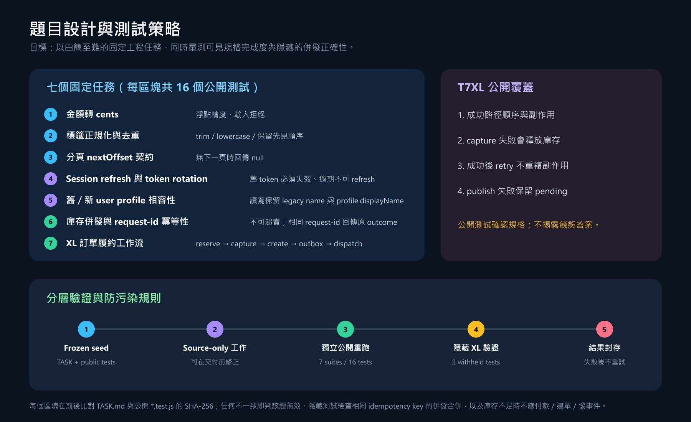
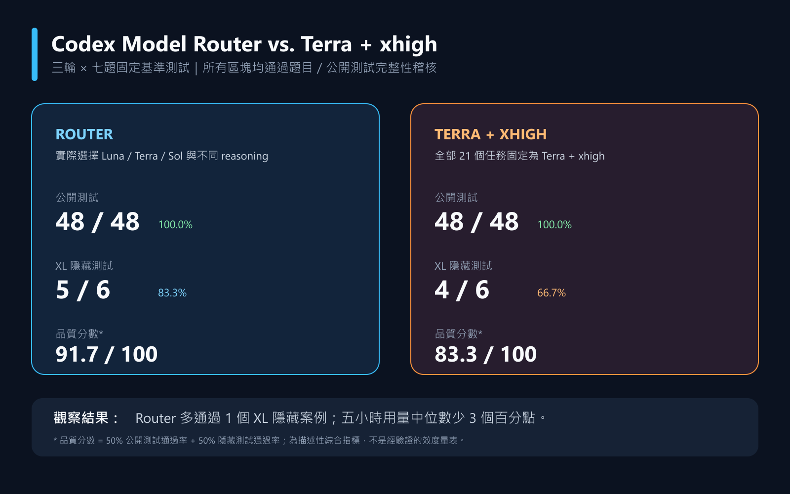
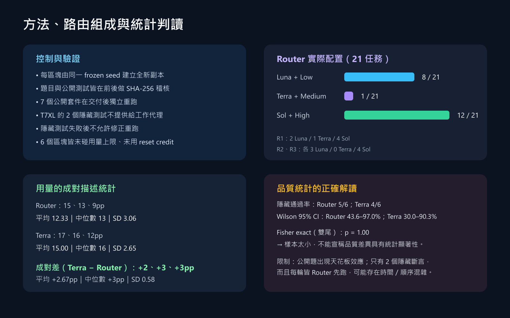
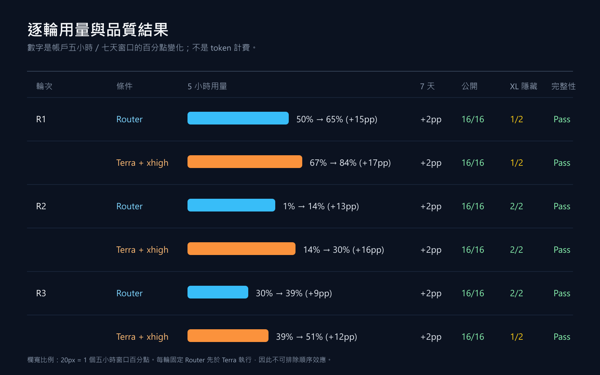

# Codex Model Router

Automatically classifies requests requiring technical execution, then runs each phase in one selected Codex subtask with the least costly suitable model and reasoning effort. The parent task receives the subtask's validated handoff and reports the result. Informational explanations and recommendations do not activate routing.

## Install

Run this in PowerShell to install directly into your local Codex skills directory:

```powershell
git clone https://github.com/Funji713/codex-model-router.git "$env:USERPROFILE\.codex\skills\codex-model-router"
```

To update an existing installation:

```powershell
git -C "$env:USERPROFILE\.codex\skills\codex-model-router" pull --ff-only
```

Start a new Codex task after installation if the current task does not discover the skill. Once discovered, the skill is eligible for automatic invocation across conversations whenever a request needs technical execution.

## Use

The skill automatically routes requests that need technical execution. You can also explicitly invoke it with the task that should be routed:

```text
$codex-model-router Investigate the failing checkout integration, implement the smallest verified fix, and run the focused tests.
```

The parent scores scope, reasoning, ambiguity, dependencies, risk, and context need from 0 to 4 each. Mechanical work and eligible scoped work start with `gpt-6.1-terra` at Low and Medium respectively. Ordinary engineering uses `gpt-6.2-sol` at Medium or High. Frontier work starts with `gpt-6.2-astra` and qualifies at score 16+ when reasoning is 3+ and ambiguity or dependencies is 3+. A smaller task can qualify with reasoning 3+ and a documented exceptional-complexity rationale. `gpt-6.2-sol` is the fallback for the other tiers and preserves the selected effort.

After phase overrides, the router automatically selects the highest qualifying Frontier effort.

| Effort | Gate |
| --- | --- |
| Ultra | Total 22+, reasoning 4, ambiguity 3+, and dependencies 3+ |
| Max | Total 20+, reasoning 4, and either ambiguity or dependencies 3+ |
| XHigh | Total 18+, or reasoning 4 with a documented exceptional Frontier rationale |
| High | Other Frontier work |

These thresholds are policy heuristics. The historical benchmark predates them.

Models outside those three require an explicit user choice and host support. Explicit reasoning settings also take precedence when supported. The execution subtask implements and validates, then returns changed paths, test results, and limitations. Once the uncertain phase is complete, implementation against a settled plan returns to Workhorse Medium.

If the current host cannot create a selected subtask, the skill stops rather than silently executing with an unselected model.

See [SKILL.md](SKILL.md) for the routing contract and [routing-policy.md](references/routing-policy.md) for the scoring and escalation policy.

The deterministic helper checks the policy without spawning workers. Supply observed host availability before acting on its recommendation:

```powershell
python scripts/route_task.py --self-test
python scripts/route_task.py --scope 3 --reasoning 3 --ambiguity 2 --dependencies 3 --risk 2 --context 3 --available-models 'gpt-6.1-terra,gpt-6.2-sol,gpt-6.2-astra' --supported-reasoning '{"gpt-6.1-terra":["Low","Medium"],"gpt-6.2-sol":["Low","Medium","High"],"gpt-6.2-astra":["High","XHigh"]}'
python scripts/route_task.py --scope 4 --reasoning 4 --ambiguity 3 --dependencies 3 --risk 4 --context 4 --available-models 'gpt-6.2-sol,gpt-6.2-astra' --supported-reasoning '{"gpt-6.2-astra":["High","XHigh","Max","Ultra"]}'
```

The two routing examples return Astra High at score 16 and Astra Ultra at score 22. For a smaller exceptional task, add `--frontier-justified --frontier-evidence "concrete rationale"`. Use `--scoped-task` for an eligible well-defined scoped fix or visual workflow. Use `--explicit-model` and `--explicit-reasoning` for user overrides. Use `--informational` to skip routing. With a supplied host reasoning map, the route blocks when the selected model is omitted or lacks the required effort.

## Historical benchmark

This small, descriptive benchmark compared an earlier routing policy with a fixed `Terra+XHigh` baseline. The models and measurements below reflect that historical run.

### Visual summary









### Results and method

- **Design:** 3 rounds × 7 fixed tasks = 21 tasks. The router always ran first, so order and time confounding remain possible.
- **Public tests:** Router 48/48; fixed `Terra+XHigh` baseline 48/48. This is a ceiling effect, not evidence that the systems are universally equivalent.
- **Hidden tests:** Router 5/6; baseline 4/6. Only two hidden assertions were available, so this is a very small signal.
- **Descriptive composite:** Router 91.7 vs baseline 83.3.
- **Router route composition:** `Luna+Low` 8/21, `Terra+Medium` 1/21, `Sol+High` 12/21.
- **Five-hour account-window usage delta:** Router average 12.33 percentage points, median 13pp; baseline average 15.00pp, median 16pp; median reduction 3pp.

Account-window percentage-point deltas are not token counts. The measurements are small-sample/descriptive only; no statistical significance claim is made (Fisher two-sided p=1.00 from the available evidence). Withheld test answers are intentionally not disclosed.
